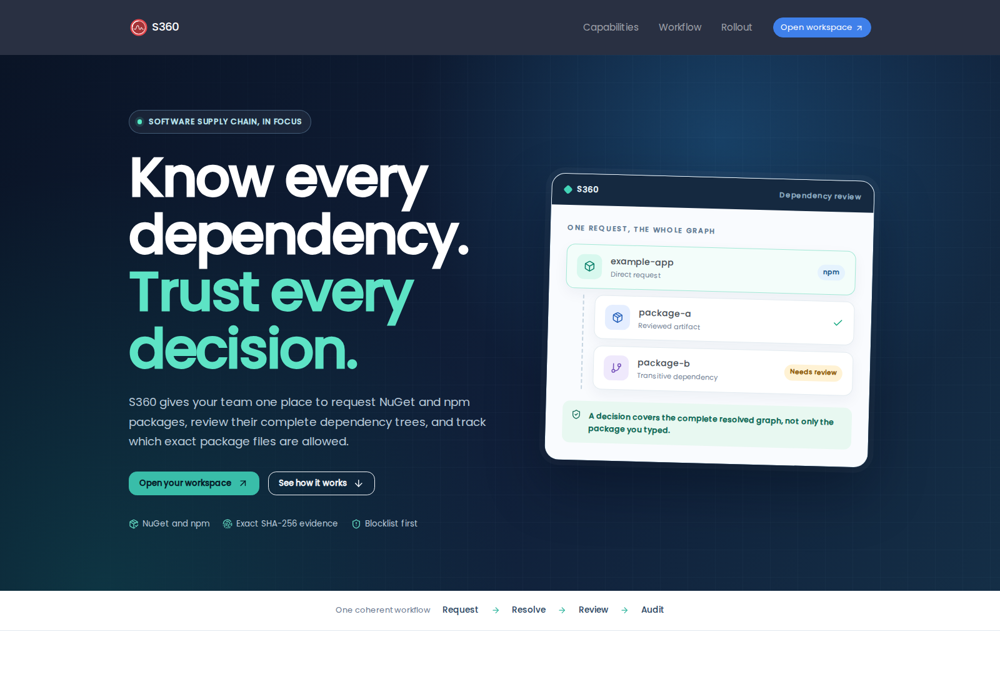

# S360 - Supply-chain control

[](https://github.com/AiursoftWeb/S360/blob/master/LICENSE)
[](https://gitlab.aiursoft.com/aiursoft/s360/-/pipelines)
[](https://gitlab.aiursoft.com/aiursoft/s360/-/pipelines)
[](https://manhours.aiursoft.com/r/github.com/AiursoftWeb/S360.html)
[](https://s360.aiursoft.com)
[](https://hub.docker.com/r/aiursoft/s360)

S360 manages NuGet and npm dependencies: employees request packages, reviewers approve dependency graphs, and teams track package files, trust rules, blocklists, and vulnerabilities.



## Try

Try the S360 Web pilot [here](https://s360.aiursoft.com) with your company account. Runner integration and CI enforcement have not been enabled.

## Install with Docker

Run the installer with the desired port (omit it to choose an available port):

```bash
curl -fsSL https://raw.githubusercontent.com/aiursoftweb/s360/master/install.sh | sudo bash -s -- 8080
```

Installation starts after three seconds; press Ctrl+C to cancel. Then open `http://localhost:8080`.

## Run manually

1. Install the .NET 10 SDK and Node.js/npm.
2. Run `npm ci --prefix src/Aiursoft.S360/wwwroot` and `npm run build --prefix src/Aiursoft.S360/wwwroot`.
3. Run `dotnet run --project src/Aiursoft.S360` and open the URL printed by the application.

The defaults use SQLite and local accounts. Configure authentication, database, and storage through [appsettings.json](src/Aiursoft.S360/appsettings.json) or environment variables.

## Run in Microsoft Visual Studio

1. Open the `.sln` file in the project path.
2. Press `F5` to run the app.

## Run in Docker

```bash
image=aiursoft/s360
appName=s360
sudo docker pull $image
sudo docker run -d --name $appName --restart unless-stopped -p 5000:5000 -v /var/www/$appName:/data $image
```

Open `http://localhost:5000`. Keep `/data` persistent for configuration, database, uploaded files, and Data Protection keys.

| Properties  | Value                  |
|-------------|------------------------|
| Image       | aiursoft/s360          |
| Ports       | 5000                   |
| Binary path | /app                   |
| Data path   | /data                  |
| Config path | /data/appsettings.json |

For company sign-in, configure `AppSettings__AuthProvider=OIDC` and the `AppSettings__OIDC__*` values. Keep client secrets outside Git and assign application permissions to the appropriate roles.

## Dependency checks

The `s360 check --path .` CLI checks restored NuGet and npm inputs against the server policy. It requires `S360_SERVER` and normally `S360_CHECK_KEY`; run `dotnet restore` and `npm ci` first. Create a personal key under **Personal → API Keys** with `CanManageApiKeys` permission; keep it out of source and logs.

By default, `--purpose review` records an audit without changing production usage. Use `--purpose baseline` only to declare dependencies already in production; it requires a baseline-enabled personal key and the owner’s current `CanPublishBaselines` permission, supplied as `S360_CHECK_KEY`. Keep that key restricted to trusted release jobs. Only a complete baseline replaces the project inventory, including when its dependencies are rejected.

Administrators can enable **Allow anonymous review** in Global Settings (default: disabled). Then review checks may omit the key; they remain unverified reports. Baseline always requires an authorized key. Checks are limited to 120 requests per minute per client IP.

Rotate keys by creating a second key, switching the caller and verifying it, then deleting the old key. Keys expire and can be disabled independently; removing the owner’s API permission or locking the account revokes access. Legacy configured check/baseline keys are no longer accepted.

Use `--ecosystem nuget` for a NuGet-only gate, or `--ecosystem npm` for npm; the default checks both. A scoped baseline updates only that ecosystem.

CLI 1.0.10 and later also report manifest-scoped dependency relationships. Open a project in **Supply chain → Projects** to explore its NuGet/npm graphs and current compliance; older reports retain their package lists until a new check is submitted.

Configure permitted registries through `SupplyChain:NuGetSources` and `SupplyChain:NpmSources`. Dependency resolution restores untrusted packages; run it in an isolated environment. The check does not prove installed files were unchanged by package scripts.

## How to contribute

Report bugs and suggestions through the issue tracker. Create a fork and a feature branch, then submit a merge request for review.
