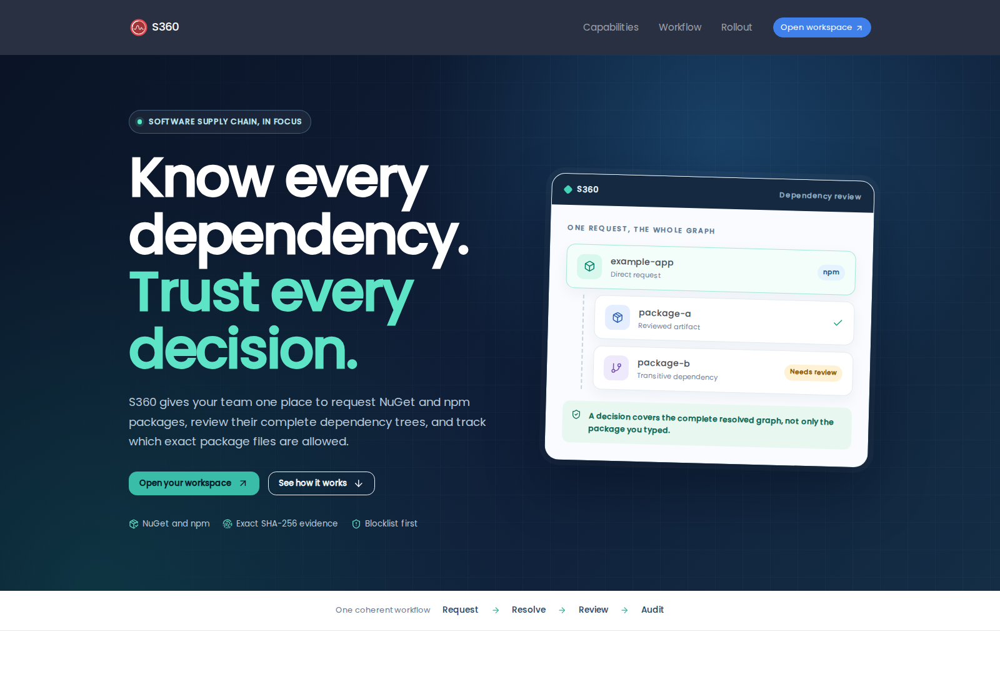

# S360 - Supply-chain control

[](https://github.com/AiursoftWeb/S360/blob/master/LICENSE)
[](https://gitlab.aiursoft.com/aiursoft/s360/-/pipelines)
[](https://gitlab.aiursoft.com/aiursoft/s360/-/pipelines)
[](https://s360.aiursoft.com/SupplyChain?tab=projects&project=aiursoft%2Fs360&scope=baseline&ecosystem=all)
[](https://manhours.aiursoft.com/r/github.com/AiursoftWeb/S360.html)
[](https://s360.aiursoft.com)
[](https://hub.docker.com/r/aiursoft/s360)

S360 manages NuGet and npm dependencies: employees request packages, reviewers approve dependency graphs, and teams track package files, trust rules, blocklists, and vulnerabilities.

## CLI & SDK

Install the CLI with the [.NET 10 SDK](https://dotnet.microsoft.com/download/dotnet/10.0):

```bash
dotnet tool install --global Aiursoft.S360.Client --add-source https://nuget.aiursoft.com/v3/index.json
```

Run `s360 --help` to explore commands. See [Dependency checks](#dependency-checks) for configuration and examples.

The [SDK source](src/Aiursoft.S360.SDK) is included in this repository; it is not published as a separate NuGet package.



## Try

Try the S360 Web pilot [here](https://s360.aiursoft.com) with your company account. Runner integration and CI enforcement have not been enabled.

## Install with Docker

Run the installer with the desired port (omit it to choose an available port):

```bash
curl -fsSL https://raw.githubusercontent.com/aiursoftweb/s360/master/install.sh | sudo bash -s -- 8080
```

Installation starts after three seconds; press Ctrl+C to cancel. Then open `http://localhost:8080`.

## Run manually

1. Install the .NET 10 SDK and Node.js/npm.
2. Run `npm ci --prefix src/Aiursoft.S360/wwwroot` and `npm run build --prefix src/Aiursoft.S360/wwwroot`.
3. Run `dotnet run --project src/Aiursoft.S360` and open the URL printed by the application.

The defaults use SQLite and local accounts. Configure authentication, database, and storage through [appsettings.json](src/Aiursoft.S360/appsettings.json) or environment variables.

## Run in Microsoft Visual Studio

1. Open the `.sln` file in the project path.
2. Press `F5` to run the app.

## Run in Docker

```bash
image=aiursoft/s360
appName=s360
sudo docker pull $image
sudo docker run -d --name $appName --restart unless-stopped -p 5000:5000 -v /var/www/$appName:/data $image
```

Open `http://localhost:5000`. Keep `/data` persistent for configuration, database, uploaded files, and Data Protection keys.

| Properties  | Value                  |
|-------------|------------------------|
| Image       | aiursoft/s360          |
| Ports       | 5000                   |
| Binary path | /app                   |
| Data path   | /data                  |
| Config path | /data/appsettings.json |

For company sign-in, configure `AppSettings__AuthProvider=OIDC` and the `AppSettings__OIDC__*` values. Keep client secrets outside Git and assign application permissions to the appropriate roles.

## Dependency checks

The CLI checks restored dependencies against the server policy. NuGet checks require an explicit `.sln` file and the .NET SDK. Use the same solution and environment for restore, check and build:

```bash
dotnet restore App.sln
s360 check --ecosystem nuget --path App.sln
dotnet build App.sln --no-restore
```

The solution's restore graph includes referenced projects even when they are not listed in the solution. Unrelated projects are excluded; missing or stale restore output inside the graph still fails. The check evaluates the graph without restoring packages. Restore with the default solution configuration; custom MSBuild command-line properties are not forwarded by the checker.

For an npm gate before installation, use CLI 1.4.0 or later:

```bash
s360 check --ecosystem npm --path . --npm-lockfile-only --purpose review
# Continue only after a successful check; npm ci uses the same checked-in lockfile.
npm ci
npm run build
```

This mode downloads and verifies the locked archives without installing packages or running their scripts. It includes optional packages for other platforms, so a Linux check also covers packages later selected by an ARM64 or Windows build. It reports the locked dependency set, not an observed installation. Use `--purpose baseline` with the existing credential for production reports. Keep the manifest and lockfile unchanged between checking and building; subsequent builds must use `npm ci`, not `npm install`.

Without `--npm-lockfile-only`, run `npm ci --ignore-scripts` first, then `s360 check --ecosystem npm --path .`; this existing mode validates the current installation and skips absent optional packages. The default ecosystem (`all`) requires a solution and also checks npm projects under its directory. From CLI 1.1.0, directory-only NuGet/all calls must pass the solution file instead.

The CLI requires `S360_SERVER` and normally `S360_CHECK_KEY`. Create a personal key under **Personal → API Keys** with `CanManageApiKeys` permission; keep it out of source and logs.

By default, `--purpose review` checks policy without saving project reports or changing production inventory. New versions within approved rules are automatically queued for independent source verification and vulnerability auditing. The CLI polls every 15 seconds for up to 10 minutes; missing approval, source/hash conflicts and known vulnerabilities remain blocking. Use `--purpose baseline` only to declare dependencies already in production; it requires a baseline-enabled personal key and the owner’s current `CanPublishBaselines` permission, supplied as `S360_CHECK_KEY`. Keep that key restricted to trusted release jobs. Only a complete baseline replaces the project inventory, including when its dependencies are rejected.

Administrators can enable **Allow anonymous review** in Global Settings (default: disabled). Then review checks may omit the key; results are returned only to the caller. Baseline always requires an authorized key. Checks are limited to 120 requests per minute per client IP. Anonymous reviews also share four concurrent slots and a budget of 20 new artifacts per minute per server process (100 total across all reviews); repeated checks reuse existing artifacts and audit triggers are coalesced.

Rotate keys by creating a second key, switching the caller and verifying it, then deleting the old key. Keys expire and can be disabled independently; removing the owner’s API permission or locking the account revokes access. Legacy configured check/baseline keys are no longer accepted.

Use `--ecosystem nuget` for a NuGet-only gate, or `--ecosystem npm` for npm; the default checks both. A scoped baseline updates only that ecosystem.

CLI 1.0.10 and later also report manifest-scoped dependency relationships. Open a project in **Supply chain → Projects** to explore its NuGet/npm graphs and current compliance; older reports retain their package lists until a new check is submitted.

Configure permitted registries through `SupplyChain:NuGetSources` and `SupplyChain:NpmSources`. Dependency resolution restores untrusted packages; run it in an isolated environment. The check does not prove installed files were unchanged by package scripts.

## Package mirror admission

Package servers can use the same personal `X-S360-Key` credential to read global artifact admission. Baseline permission is not required. Anonymous review never enables these endpoints.

- `GET /api/artifacts/approved?ecosystem=nuget&source=<encoded-origin>&take=100` lists existing, independently verified artifacts that currently pass policy. Both NuGet and npm are supported. Follow `nextAfterId` with `afterId` and retain `upperId` until `nextAfterId` is null, including when a page contains no artifacts. `take` is limited to 500.
- `POST /api/artifacts/assess` accepts `{ "dependencies": [...] }`, with 1–500 exact ecosystem/name/version/source/SHA256 identities, and returns ordered `decisions`. Reassess before serving cached archives; enumeration is not a lasting authorization.

Both endpoints enforce permitted registries, approved version grants, independent source verification, current vulnerability audits, blocks and revocation. They do not observe new artifacts, queue work, pin hashes, or publish project reports. A globally approved archive does not authorize a project dependency graph. Keep the verified origin distinct from a mirror's distribution address.

## How to contribute

Report bugs and suggestions through the issue tracker. Create a fork and a feature branch, then submit a merge request for review.
