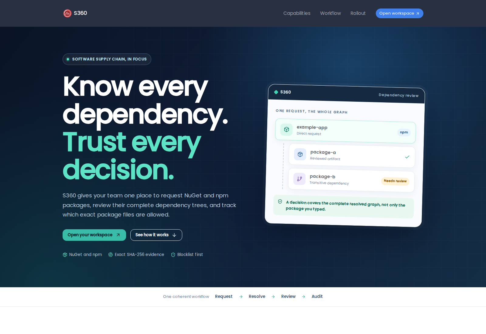

# Aiursoft S360 - Supply-chain control

<a name="s360---supply-chain-control"></a>

[](https://github.com/AiursoftWeb/S360/blob/master/LICENSE)
[](https://gitlab.aiursoft.com/aiursoft/s360/-/pipelines)
[](https://gitlab.aiursoft.com/aiursoft/s360/-/pipelines)
[](https://s360.aiursoft.com/SupplyChain?tab=projects&project=aiursoft%2Fs360&scope=baseline&ecosystem=all)
[](https://manhours.aiursoft.com/r/github.com/AiursoftWeb/S360.html)
[](https://s360.aiursoft.com)
[](https://hub.docker.com/r/aiursoft/s360)

S360 records which NuGet and npm packages your team may use, checks known vulnerabilities, and alerts affected projects. Package servers handle downloading, integrity checks, and caching.



## Overview

S360 records package admission rules, checks vulnerabilities and reports affected projects. Package servers download and cache artifacts; S360 supplies policy decisions.

## CLI & SDK

### CLI

Install the CLI with the [.NET 10 SDK](https://dotnet.microsoft.com/download/dotnet/10.0):

```bash
dotnet tool install --global Aiursoft.S360.Client
```

Update an existing installation:

```bash
dotnet tool update --global Aiursoft.S360.Client
```

Remove the CLI:

```bash
dotnet tool uninstall --global Aiursoft.S360.Client
```

Run `s360 --help` to explore commands.

See [Dependency checks](#dependency-checks) for configuration and examples.

### SDK

The [SDK source](https://github.com/aiursoftweb/s360/tree/master/src/Aiursoft.S360.SDK) is included in this repository; it is not published as a separate NuGet package.

## Try

Try a running S360 [here](https://s360.aiursoft.com). Sign in with your company account.

## Install with Docker

Run the installer with the desired port (omit it to choose an available port):

```bash
curl -fsSL https://raw.githubusercontent.com/aiursoftweb/s360/master/install.sh | sudo bash -s -- 8080
```

Installation starts after three seconds; press Ctrl+C to cancel. Then open `http://localhost:8080`.

## Run manually

Requirements about how to run

1. Install [.NET 10 SDK](https://dotnet.microsoft.com/download/dotnet/10.0) and [Node.js](https://nodejs.org/).
2. Execute `npm ci --prefix src/Aiursoft.S360/wwwroot` and `npm run build --prefix src/Aiursoft.S360/wwwroot` from the repository root to prepare the frontend assets.
3. Execute `dotnet run --project src/Aiursoft.S360/Aiursoft.S360.csproj -- --urls http://localhost:5000` to run the app.
4. Use your browser to view [http://localhost:5000](http://localhost:5000).

## Run in Microsoft Visual Studio

1. Prepare the frontend assets as described above.
2. Open `Aiursoft.S360.sln`, select `Aiursoft.S360` as the startup project, and press `F5`.

## Run in Docker

First, install Docker [here](https://docs.docker.com/get-docker/).

Then run the following commands in a Linux shell:

```bash
image=aiursoft/s360
appName=s360
sudo docker pull $image
sudo docker run -d --name $appName --restart unless-stopped -p 5000:5000 --mount type=volume,source=$appName-data,target=/data $image
```

That will start a web server at `http://localhost:5000` and you can test the app.

The docker image has the following context:

| Properties  | Value                           |
|-------------|---------------------------------|
| Image       | aiursoft/s360               |
| Ports       | 5000                            |
| Binary path | /app                            |
| Data path   | /data                           |
| Config path | /data/appsettings.json          |

Keep `/data` persistent for configuration, the SQLite database, uploaded files and Data Protection keys. To use a host directory instead of the named volume, replace the mount argument with `-v /var/www/$appName:/data`.

## Usage

### Dependency checks

The CLI checks restored dependencies against the server policy. NuGet checks require an explicit `.sln` file and the .NET SDK. Use the same solution and environment for restore, check and build:

```bash
dotnet restore App.sln
s360 check --ecosystem nuget --path App.sln
dotnet build App.sln --no-restore
```

The solution's restore graph includes referenced projects even when they are not listed in the solution. Unrelated projects are excluded; missing or stale restore output inside the graph still fails. The check evaluates the graph without restoring packages. Restore with the default solution configuration; custom MSBuild command-line properties are not forwarded by the checker.

For an npm gate before installation, use CLI 1.4.0 or later:

```bash
s360 check --ecosystem npm --path . --npm-lockfile-only --purpose review
# Continue only after a successful check; npm ci uses the same checked-in lockfile.
npm ci
npm run build
```

This mode reads the locked package names, versions, and sources without downloading archives or running package scripts. It includes optional packages for other platforms, so a Linux check also covers packages later selected by an ARM64 or Windows build. It reports the locked dependency set, not an observed installation. Use `--purpose baseline` with the existing credential for production reports. Keep the manifest and lockfile unchanged between checking and building; subsequent builds must use `npm ci`, not `npm install`.

When CI uses `replace-registry-host=always`, pass `--npm-registry https://nopkg.aiursoft.com/npm/` to audit the same registry used by npm. The selected registry is reported as the package source; the lockfile stays unchanged. npm remains responsible for archive integrity and installation. Direct archive URLs are rejected in this mode. Omit the option to retain the original lockfile-source checks. Selected registries with path prefixes (such as `/npm`) are validated and reported with that full prefix.

Without `--npm-lockfile-only`, run `npm ci --ignore-scripts` first, then `s360 check --ecosystem npm --path .`; this existing mode validates the current installation and skips absent optional packages. The default ecosystem (`all`) requires a solution and also checks npm projects under its directory. From CLI 1.1.0, directory-only NuGet/all calls must pass the solution file instead.

The CLI requires `S360_SERVER` and normally `S360_CHECK_KEY`. Create a personal key under **Personal → API Keys** with `CanManageApiKeys` permission; keep it out of source and logs.

By default, `--purpose review` checks policy without saving project reports or changing production inventory. Approved version ranges cover new versions without file verification. If vulnerability data needs refreshing, the existing background audit is queued. The CLI polls every 15 seconds for up to 10 minutes; missing approval, revoked rules and known vulnerabilities remain blocking. Use `--purpose baseline` only to declare dependencies already in production; it requires a baseline-enabled personal key and the owner’s current `CanPublishBaselines` permission, supplied as `S360_CHECK_KEY`. Keep that key restricted to trusted release jobs. Only a complete baseline replaces the project inventory, including when its dependencies are rejected.

Administrators can enable **Allow anonymous review** in Global Settings (default: disabled). Then review checks may omit the key; results are returned only to the caller. Baseline always requires an authorized key. Checks are limited to 120 requests per minute per client IP. Anonymous reviews also share four concurrent slots; repeated requests coalesce vulnerability refreshes.

Rotate keys by creating a second key, switching the caller and verifying it, then deleting the old key. Keys expire and can be disabled independently; removing the owner’s API permission or locking the account revokes access. Legacy configured check/baseline keys are no longer accepted.

Use `--ecosystem nuget` for a NuGet-only gate, or `--ecosystem npm` for npm; the default checks both. A scoped baseline updates only that ecosystem.

CLI 1.0.10 and later also report manifest-scoped dependency relationships. Open a project in **Supply chain → Projects** to explore its NuGet/npm graphs and current compliance; older reports retain their package lists until a new check is submitted.

Configure permitted registries through `SupplyChain:NuGetSources` and `SupplyChain:NpmSources`. S360 treats these URLs as policy identities; it does not contact them. Requests contain package names and versions, and CI reports resolved dependency lists. S360 never restores dependencies or downloads package archives.

### Package server integration

Package servers query the existing `POST /api/artifacts/assess` endpoint with a personal `X-S360-Key`. Each dependency contains `ecosystem`, `name`, `version`, and `source`; no package file or hash is required. The response reports whether current rules and vulnerability data allow that version. Baseline permission is not required.

A registry can use its internal distribution URL as the policy source. Approve the package once for that source; the registry chooses and contacts its upstream. S360 requires no upstream mapping and never calls a registry.

Recheck before serving cached packages so revocation and new vulnerabilities take effect. Unavailable or stale vulnerability data is reported as pending, not as a clean result. Project inventory and AlertCenter delivery are separate from these read-only queries.

`GET /api/artifacts/approved` retains pagination for observed versions that currently pass policy. It is not an exhaustive list of versions covered by wildcard grants; assess exact candidate versions before use. The previous mirror routes remain read-only compatibility aliases during client upgrades; they no longer download or verify files.

## Configuration

<a name="configuration-guide"></a>

The defaults run as a standalone application with SQLite, local accounts, local file storage, and no ClickHouse server. Change a setting only after preparing the dependency named in its comment.

The Docker image copies this file to `/data/appsettings.json` on its first start and keeps that copy on later starts. Mount `/data` as a persistent volume. To override a value without editing the file, use an environment variable with double underscores, such as `Storage__Path` or `AppSettings__OIDC__ClientSecret`.

```jsonc
{
  "ConnectionStrings": {
    // True: cache EF Core query results in this process. False: read from the database on every query.
    "AllowCache": "True",

    // Sqlite: use a local database file and no database server. MySql: use an external MySQL server.
    // When changing this value, also replace DefaultConnection with a connection string for that provider.
    "DbType": "Sqlite",
    // With Sqlite, this creates app.db in the process working directory and applies migrations at startup.
    "DefaultConnection": "DataSource=app.db;Cache=Shared"

    // MySql requires a reachable server, database, user, and password. The application applies migrations at startup.
    // sudo docker run -d --name db -e MYSQL_RANDOM_ROOT_PASSWORD=true -e MYSQL_DATABASE=template -e MYSQL_USER=template -e MYSQL_PASSWORD=template_password -p 3306:3306 hub.aiursoft.com/mysql
    //"DbType": "MySql",
    //"DefaultConnection": "Server=localhost;Database=template;Uid=template;Pwd=template_password;"
  },
  "Storage": {
    // Writable local directory for public Workspace files and token-protected private Vault files.
    // This is not an S3 or MinIO bucket.
    // The Docker image changes /tmp/data to /data; mount /data as a persistent volume in production.
    "Path": "/tmp/data",

    // Optional second hostname for this application's own /download endpoints; this is not an S3 or MinIO URL.
    // Example: set https://files.example.com, point that DNS name to this server, and add this Caddy route:
    // files.example.com {
    //     reverse_proxy 127.0.0.1:5000
    // }
    // Replace 127.0.0.1:5000 with the same upstream used by the web UI. Leave empty to use the UI hostname.
    "PublicOrigin": "",

    // False: verified images and configured media can open on the normal web hostname.
    // True: inline viewing works only through PublicOrigin; the same request on the UI hostname downloads the file.
    // True requires PublicOrigin plus DNS, TLS, and a reverse-proxy route to this same application instance.
    "RequireDedicatedInlineOrigin": false,

    // False: only verified images and SafeInlineMediaExtensions open in the browser; every other file downloads.
    // True: every file type may open through PublicOrigin, and HTML or SVG scripts may run there.
    // True requires RequireDedicatedInlineOrigin=true and a PublicOrigin that receives no application cookies.
    "AllowArbitraryInlineOnDedicatedOrigin": false,

    // File extensions allowed to open after content-signature validation. Empty means no extra audio, video, or SVG.
    // Supported values are mp3, mp4, ogg, svg, wav, and webm. This does not grant upload permission.
    "SafeInlineMediaExtensions": ["svg"],

    // SVG opens only when svg is enabled above and its Workspace path starts with an entry in this list.
    // Example: [ "markdown-images" ]. Empty means every SVG downloads.
    "SafeInlineSvgSubfolders": ["project-logo"],

    // These values are copied into newly issued signed upload tokens; existing tokens keep their old policy.
    "UploadPolicy": {
      // False: a valid signed upload token is enough. True: the uploader must also be signed in to this application.
      "RequireAuthenticatedUser": false,

      // False: preserve spaces in uploaded file names. True: save each space as a hyphen.
      "ReplaceSpacesWithHyphens": false
    }
  },
  "SupplyChain": {
    // Shared per-instance OSV request spacing, including retries (100-60000 ms).
    "OsvRequestIntervalMilliseconds": 500,
    // Employee resolution is restricted to these administrator-configured sources.
    "NuGetSources": ["https://nuget.aiursoft.com/v3/index.json"],
    "NpmSources": ["https://npm.aiursoft.com"],
    // Optional operator-defined internal registry -> independent upstream verification.
    // Example entry: { "Ecosystem": "nuget", "Source": "https://nupkg.aiursoft.com/v3/index.json", "Upstream": "https://api.nuget.org/v3/index.json" }
    "Mirrors": []
  },
  "AppSettings": {
    // Local: use built-in accounts and passwords. OIDC: redirect sign-in to an external identity provider.
    // OIDC also requires the OIDC section below and a provider callback URL of https://<web-host>/signin-oidc.
    "AuthProvider": "Local",

    // Empty: assign no automatic role. Otherwise, assign this role to every new local or OIDC user.
    // With Local, create the role first. With OIDC, the application creates it during account synchronization.
    "DefaultRole": "",

    // False: sign-in ends when the browser session closes. True: issue a persistent sign-in cookie.
    "PersistsSignIn": false,

    // This section is used only when AuthProvider is OIDC.
    "OIDC": {
      // Provider discovery base URL. It must be reachable by the application and should use HTTPS in production.
      "Authority": "https://auth.aiursoft.com/application/o/template",
      // Client identifier created for this application in the OIDC provider.
      "ClientId": "",
      // Client secret created by the provider. Set AppSettings__OIDC__ClientSecret instead of committing a real secret.
      "ClientSecret": "",

      // Claim containing role names. On every login, local roles are replaced by these roles plus DefaultRole.
      "RolePropertyName": "groups",
      // Required claim used as the local username when an OIDC account is first created.
      "UsernamePropertyName": "preferred_username",
      // Required claim copied to the local display name on every login.
      "UserDisplayNamePropertyName": "name",
      // Required unique email claim. The provider must keep it verified, unique, and stable.
      "EmailPropertyName": "email",
      // Required immutable account identifier. Keep this mapped to the standard OIDC sub claim.
      "UserIdentityPropertyName": "sub"
    },

    // This section is used only when AuthProvider is Local.
    "Local": {
      // True: show self-registration and allow new local accounts. False: existing users can sign in, but cannot register.
      "AllowRegister": true,
      // True: require only six characters. False: require eight characters with upper, lower, digit, and symbol.
      "AllowWeakPassword": true
    }
  },
  "GlobalSettings": {
    // Leave an entry commented to use the database value or built-in default.
    // Uncommenting an entry forces that value and overrides changes made in the administration UI.

    // True: users may change their display nickname. False: only administrators control it.
    // "Allow_User_Adjust_Nickname": "True",
    // Text shown as the brand name in the footer.
    // "BrandName": "Aiursoft",
    // URL opened when a user clicks the footer brand name.
    // "BrandHomeUrl": "https://www.aiursoft.com/",
    // Mainland China ICP license number. Empty hides it.
    // "Icp": "",
    // Application name shown in the web interface.
    // "ProjectName": "Aiursoft Template"
  },
  "Logging": {
    "LogLevel": {
      // Minimum level for application logs. Typical values: Debug, Information, Warning, Error, or None.
      "Default": "Information",
      // Separate minimum level for ASP.NET Core framework logs; Warning reduces routine request noise.
      "Microsoft.AspNetCore": "Warning"
    },
    "Clickhouse": {
      // False: do not send logs to ClickHouse. True: create TableName at startup and send logs in batches.
      // Before enabling, provide a reachable ClickHouse server and valid credentials in ConnectionString.
      "Enabled": false,
      // ClickHouse host, protocol, port, credentials, and database. Used only when Enabled is true.
      "ConnectionString": "Host=localhost;Protocol=http;Port=8123;User=default;Password=;Database=AspNetCoreLogs",
      // ClickHouse table created and used for application logs when Enabled is true.
      "TableName": "TemplateLogs"
    }
  },
  // ASP.NET Core Host-header allowlist; this is not a CORS setting.
  // * accepts every hostname. In production, use semicolon-separated names such as example.com;www.example.com.
  "AllowedHosts": "*"
}
```

### Shared settings

- `ConnectionStrings:AllowCache` caches EF Core query results in-process. Choose `Sqlite` for a local file or `MySql` for a prepared external database; change `DefaultConnection` with the provider. Migrations are applied at startup.
- `Storage:Path` is writable local file storage for Workspace and Vault. `PublicOrigin` is an optional second hostname routed to this same application's downloads, not an object-storage endpoint. Dedicated inline viewing requires its own DNS, TLS and reverse-proxy route; arbitrary inline content must use a cookie-free dedicated origin. Media/SVG allowlists constrain inline rendering, not upload permission. Upload token policy changes apply to newly issued tokens.
- `AppSettings:AuthProvider` selects `Local` accounts or `OIDC`. OIDC requires a reachable authority, client settings and the HTTPS `/signin-oidc` callback. Configure role, username, display-name, email and immutable `sub` claims; synchronized OIDC roles and `DefaultRole` govern local membership. `PersistsSignIn` controls persistent cookies. Local registration and password requirements follow `AppSettings:Local`.
- Uncommented `GlobalSettings` values override the database-backed administration UI; commented entries leave its values or built-in defaults in use.
- `Logging:LogLevel` controls application/framework verbosity. `Logging:Clickhouse` is optional application-log export and requires a prepared reachable database when enabled.
- `AllowedHosts` is the ASP.NET Core Host-header allowlist, not CORS. Use the intended public hostnames for a deployment.

`SupplyChain:NuGetSources` and `SupplyChain:NpmSources` are policy source identities; configure the URLs actually reported by your clients. The `Mirrors` example retained in the source defaults is legacy configuration, not an upstream-verification requirement: S360 makes policy/vulnerability decisions and never calls registries. See [Package server integration](#package-server-integration).

## Documentation

- [Dependency checks](#dependency-checks)
- [Package server integration](#package-server-integration)
- [Configuration reference](https://github.com/aiursoftweb/s360/blob/master/src/Aiursoft.S360/appsettings.json)

## How to contribute

There are many ways to contribute to the project: logging bugs, submitting pull requests, reporting issues, and creating suggestions.

Even if you have push rights on the repository, you should create a personal fork and create feature branches there when you need them. This keeps the main repository clean and your workflow cruft out of sight.

We're also interested in your feedback on the future of this project. You can submit a suggestion or feature request through the issue tracker. To make this process more effective, we're asking that these include more information to help define them more clearly.

## License

Licensed under the [MIT License](https://github.com/aiursoftweb/s360/blob/master/LICENSE).
